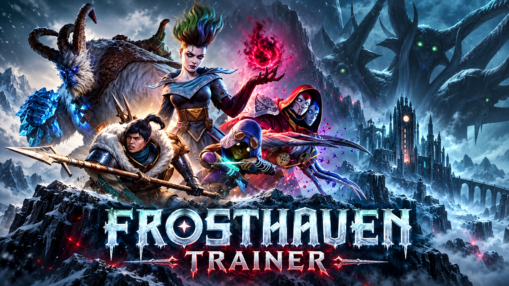

# Frosthaven — Trainer

**No hand exhaustion, modifier deck control, infinite gold and outpost resources, all 17 heroes unlocked, every scenario open, faster enemy turns.**

    

> **[⬇️ Download the latest Frosthaven trainer](../../releases/latest)**

    

[House rules first](#check-the-house-rules-first) · [Settings](#settings) · [Questions](#questions)

---

## Check the house rules first

Snapshot Games put a **customisable house rules panel** in the game, and it covers more than people expect: difficulty scaling, campaign conveniences, several of the fiddly board-game bookkeeping rules you may not want to enforce on yourself. If what you want is "a slightly gentler campaign," that panel is the correct tool and it is already installed.

What it does not do is hand you gold, unlock a hero you have not earned, or make the enemy turn animation play at double speed. That is what this is for.

## What this is for

Frosthaven is a 1.0 release of an enormous board game: seventeen heroes, a full story campaign, an outpost you build and defend between scenarios, and card-driven combat where running out of cards removes you from the fight. Julian Gollop's studio spent fifteen months in Early Access getting the adaptation right, and the result is faithful — including the parts that were already a lot of bookkeeping on a table.

Most of what is here targets the campaign layer rather than the tactics. Resource grinding for outpost buildings, gold for items you already know you want, heroes gated behind retirements you have not reached yet. The combat options exist, but a scenario you win with an unlimited hand is not a scenario you played.

The option most people will keep switched on permanently is not a cheat at all: **enemy turn speed**. See below.

## Settings

### Pacing

Digital board games have one universal complaint and this is it.

| Setting | Key | Scope |
|---|---|---|
| Enemy turn speed `1x`–`10x` | slider | Client |
| Skip movement animations | — | Client |
| Skip card reveal animations | — | Client |
| Instant modifier draws | — | Client |
| Auto-advance end-of-round prompts | — | Client |
| Combat log verbosity | dropdown | Client |

None of this changes a single outcome. A six-enemy room still takes the same number of decisions; it just stops taking ninety seconds of watching figures slide across hexes. If you install this and use nothing else, use this.

### Party

| Setting | Key | Scope |
|---|---|---|
| Infinite hit points | <kbd>F1</kbd> | Client |
| No hand exhaustion | <kbd>F2</kbd> | Client — you never run out of cards |
| Cards never lost on rest | <kbd>F3</kbd> | Client |
| Lost cards return to hand | — | Client |
| Infinite loss-card uses | — | Client |
| Unlimited movement range | — | Client |
| Set initiative manually | <kbd>F4</kbd> | **`crew`** — reorders the round for everyone |
| Experience multiplier `1x`–`50x` | slider | Client |
| Hero level `1`–`9` | slider | `save` |
| All perks unlocked | — | `save` |

### Combat

| Setting | Key | Scope |
|---|---|---|
| Attack modifier always best result | <kbd>F5</kbd> | Client |
| Modifier deck control | dropdown | Client — force a specific draw |
| Remove all curses | — | Client |
| Infinite blesses | — | Client |
| Damage multiplier `1x`–`25x` | slider | Client |
| Incoming damage `0%`–`100%` | slider | Client |
| Enemy health `1%`–`300%` | slider | **`crew`** — raises as well as lowers |
| Freeze enemy AI | <kbd>F6</kbd> | **`crew`** |
| Reveal enemy initiative early | — | Client |
| Scenario level `0`–`7` | slider | **`crew`** |

Enemy health and scenario level both go up. Frosthaven at level 7 with a party that has outscaled it is a more interesting use of a trainer than level 0 with infinite cards.

### Outpost

The town layer is where the grind lives, and where most of these earn their place.

| Setting | Key | Scope |
|---|---|---|
| Infinite gold | <kbd>F7</kbd> | **`crew`** — shared party funds |
| Infinite resources | <kbd>F8</kbd> | **`crew`** — lumber, metal, hide, all of it |
| Resource multiplier `1x`–`50x` | slider | **`crew`** |
| Instant building construction | — | **`crew`** |
| Buildings never damaged | — | **`crew`** |
| Skip outpost attacks | — | **`crew`** |
| Prosperity level `1`–`9` | slider | `save` |
| Season control | dropdown | **`crew`** — winter or summer on demand |
| Infinite inspiration | — | `save` |

### Campaign

| Setting | Scope |
|---|---|
| Unlock all 17 heroes | `save` |
| Unlock all scenarios | `save` |
| Unlock all items and equipment | `save` |
| Complete personal quests | `save` — triggers retirement eligibility |
| Reveal campaign branches | `save`, `spoiler` — off by default |
| Unlock the full codex | `save` |
| Reset a retired hero | `save` |

**Reveal campaign branches** is the only spoiler-tagged setting here, and it is off. Frosthaven's campaign forks on choices you make, and a map of the forks is a map of the story.

### Display and menu

Board zoom past the built-in limit, camera tilt lock, hide interface <kbd>F11</kbd>, high-contrast hex grid, larger card text, colour-blind modifier deck symbols, screenshot mode. Plus host-only mode, rolling save backup, read-only mode, achievement blocking, rebindable menu key.

Larger card text and the high-contrast grid are worth a look even if you want nothing else — a lot of Frosthaven is reading dense card text at desk distance.

## Keys

<kbd>Insert</kbd> menu · <kbd>End</kbd> reset all · <kbd>F1</kbd> infinite HP · <kbd>F2</kbd> no exhaustion · <kbd>F3</kbd> keep cards on rest · <kbd>F4</kbd> set initiative · <kbd>F5</kbd> best modifier draw · <kbd>F6</kbd> freeze enemies · <kbd>F7</kbd> infinite gold · <kbd>F8</kbd> infinite resources · <kbd>F11</kbd> hide HUD

All rebindable. Arrows and <kbd>Enter</kbd> work without a mouse.

## Two sensible configurations

**Campaign convenience, tactics untouched:** enemy turn speed 4x, skip movement animations, infinite resources, resource multiplier off. Every scenario is still fought exactly as designed — you simply stop grinding lumber and stop watching hexes.

**The one that ends the game:** no hand exhaustion plus best modifier draw. Frosthaven's entire tension is a hand of cards burning down while the room is still full. Remove the burn and the deck-building, the rest decisions and the loss cards all stop mattering at once. It is a bigger change than infinite HP, and people underestimate it.

Anything marked `save` writes to the campaign file. Frosthaven campaigns run for dozens of hours — the rolling backup is on by default and should stay that way.

## Questions

Can this get me into trouble?

There is no ranked play, no leaderboard and no anti-cheat. Frosthaven is you and up to three friends against the scenario. The only people affected by a <code>crew</code> setting are the ones in your campaign.

Should I use the in-game house rules instead?

For difficulty, yes, almost always. They were balanced by the developers and they apply cleanly. Reach for this when you want something the rules panel does not offer — resources, unlocks, animation speed.

Does it work with the Epic Games Store build?

Yes. Launch through the Epic client rather than the executable so the process starts in the right environment.

Will it break a campaign save?

Settings tagged <code>save</code> rewrite campaign state — hero levels, prosperity, retirements, scenario unlocks. The game was not designed for those values to change out of sequence, so a backup before you touch them is not optional advice. Everything untagged is runtime-only.

Can I use it in online co-op?

Client-side settings, freely. Anything marked <code>crew</code> changes the shared campaign, and host-only mode blocks those for guests by default. Gold and resources are party-wide in Frosthaven, so even those are <code>crew</code>.

Options stopped responding after a patch.

Frosthaven only just left Early Access and is still patching. Address shifts break settings individually rather than all at once; match your build against the release notes, or switch on read-only mode to see what the menu can still read correctly.

My security software objected to the download.

Any tool that reads and writes another running program's memory looks like a threat to heuristic scanning, because that is also what several categories of malware do. Every release carries a checksum and the source sits in this repository. Add an exclusion or do not — both are reasonable positions.

## When something misbehaves

| What you see | What to do |
|---|---|
| Menu will not open | Steam, Discord or RTSS took <kbd>Insert</kbd>. Rebind it. |
| Attach fails | Load a campaign first; there is no process state on the main menu. |
| Combat settings inert | They bind on scenario start, not in the outpost. |
| Outpost settings inert | Opposite problem — those bind in the outpost, not mid-scenario. |
| Unlocks reverted after a patch | Restore a backup from before the update. |
| Initiative changes desync in co-op | Initiative reorders the round for everyone; the host should set it. |

[Open an issue](../../issues) with the **game build number** first, then store, host or guest, which scenario or outpost screen, and the one setting that failed.

## Version history

**1.0.0** — 18 October 2026 — first build against the 1.0 release. 45+ settings across Pacing, Party, Combat, Outpost, Campaign and Display. Host-only mode and rolling backup on by default; campaign branch reveal off by default.

---

Unofficial fan tool, unaffiliated with Snapshot Games, Arc Games, Cephalofair Games or Valve. Frosthaven is Isaac Childres' design and theirs to publish. Writing into a live process risks crashes and save damage — back up your campaign. MIT licence.

